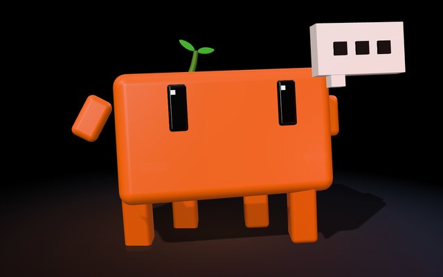
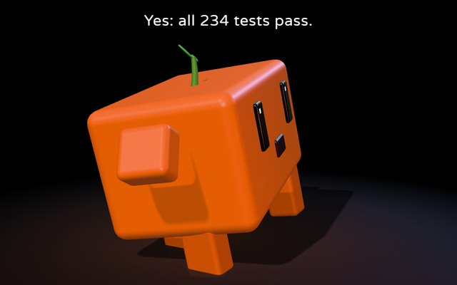
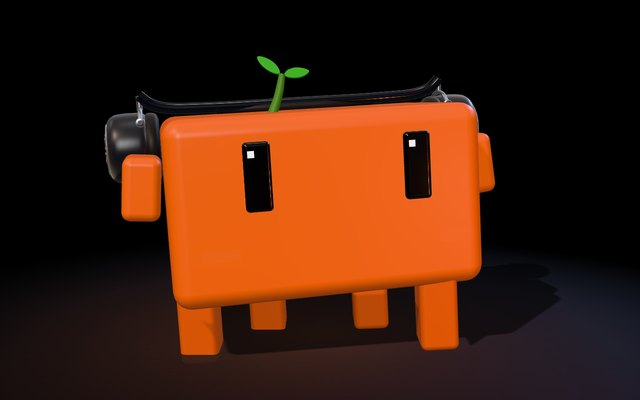
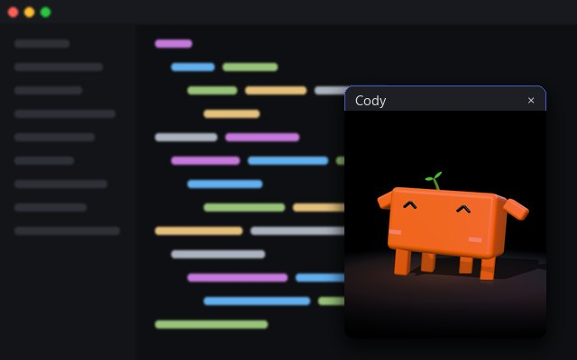

<p align="center">
  
</p>

<h1 align="center">Your Claude Code, alive on your desk.<br>Talk to it, and it codes.</h1>

<p align="center">
  <b>Claude Code was already brilliant. Now it has a face, a voice and a way to find you.</b><br>
  Cody is a little orange companion wired into the real Claude Code on your computer.<br>
  Watch it work. Tell it what to build. Walk away, and it comes to get you.
</p>

<p align="center">
  <a href="https://github.com/baconshow/cody/releases/latest/download/CodySetup.exe"></a>
  <a href="https://baconshow.github.io/cody/"></a>
</p>

<p align="center"><sub>Free and open source (MIT) · runs on the Claude plan you already have · no API key · nothing is sent to the author</sub></p>

<p align="center">
  <a href="#just-say-it">Just say it</a> ·
  <a href="#your-phone-is-a-remote-for-claude-code">Your phone</a> ·
  <a href="#it-comes-to-get-you">Heads-up</a> ·
  <a href="#it-redraws-itself">It redraws itself</a> ·
  <a href="#install-in-three-steps">Install</a> ·
  <a href="#questions">Questions</a> ·
  <a href="docs/MANUAL.md">Full manual</a>
</p>

<table>
<tr>
<td width="50%"></td>
<td width="50%"></td>
</tr>
</table>
<p align="center"><sub>The real Cody; the terminals and the cards are drawn, with made-up commands.</sub></p>

## Not a chatbot with a face. Claude Code with a face.

Most AI companions are a chat window in a costume. Cody is the other way around: the costume is on the outside, and
inside is Claude Code itself, the same agent that edits your files, runs your tests and ships your work.

- **It sees.** Every Claude Code session on your computer, live, in a terminal or in the Claude Desktop app's Code
  tab. Claude searches: Cody grabs a magnifier. Claude writes code: Cody types on a tiny keyboard. Something fails: a
  bug crawls in and the DEBUG MODE sign lights up.
- **It listens.** Say *"Cody"* and talk. Your words go straight into a real Claude Code session, with your files,
  your tools and your MCP servers. Pick a voice and it talks back.
- **It acts.** It changes your code, starts your servers, sets timers, remembers how you like things, and passes
  messages to your other Claude Code sessions.
- **It comes to get you.** Turn on heads-up: a long task is done, Cody cheers; Claude is stuck waiting for your
  permission, Cody knocks on the screen and tells you.

<h2 align="center">Looks like a toy.<br>Works like Claude Code.</h2>

## Just say it

You are on the couch. The laptop is across the room. You do not feel like typing. You do not have to.

| You say | What happens |
|---|---|
| *"Cody, start the server."* | Claude finds the project, reads its port and starts it. Cody tells you it is up (the GIF above). |
| *"Fix the typo on the login page."* | Claude edits the file in your project. The details wait for you in the voice session. |
| *"Tell the payments session to run the tests."* | Claude messages that other Claude Code session, which does what its own permissions allow. |
| *"How much usage do I have left?"* | Your five hour window and your week, said out loud and shown on screen (one switch in Settings). |
| *"Remind me to take the pizza out in twelve minutes."* | A timer that rings wherever Cody is open: the computer or your phone. |
| *"Draw a mustache on yourself."* | Claude draws it, and Cody puts it on. |

And when Claude wants to run a command, Cody asks you first. Just say *yes* or *no*.

## Your phone is a remote for Claude Code

One button in Settings sets up your own private network with [Tailscale](https://tailscale.com) (free) and shows the
QR codes. Scan them, and Cody is on your phone. Talk to Claude Code from the kitchen. Send it a photo with the clip. Get a
screenshot of your computer with a Share button. Only your own devices get in.

## It comes to get you

Stop babysitting the terminal. Turn on heads-up, and when a long task finishes, Cody cheers. When Claude is waiting for
your permission in another session, Cody knocks on the screen and says so. Keep Cody in view, on the computer, in its
little floating window or on your phone, and it calls you back.

## It redraws itself

Cody's scenes are data, not code, so Claude can make new ones for it, by voice. Ask for a mustache, a party hat, a sign
with your team's name: Claude writes the scene, Cody checks every field and wears it. Then pick a whole new look in
Settings > Skins: a pumpkin with a witch hat, an aviator, the boss in sunglasses.

<table>
<tr>
<td align="center" width="33%"><br><b>Types along</b><br><sub>while Claude writes code</sub></td>
<td align="center" width="33%"><br><b>Thinks with it</b><br><sub>while commands run</sub></td>
<td align="center" width="33%"><br><b>Talks back</b><br><sub>a real Claude Code session, out loud</sub></td>
</tr>
<tr>
<td align="center"><br><b>Dresses up</b><br><sub>a pumpkin, an aviator, the boss</sub></td>
<td align="center"><br><b>Vibes with you</b><br><sub>headphones on when your music plays (Windows)</sub></td>
<td align="center"><br><b>Floats over your apps</b><br><sub>a little window (from Chrome or Edge)</sub></td>
</tr>
</table>
<p align="center"><sub>The real page; the words in "Talks back" and the desktop in "Floats over your apps" are added.</sub></p>

## And a few more tricks

- **A memory.** Your name and how you like your answers, saved on your computer between sessions.
- **Screenshots on request.** *"Cody, take a screenshot"* and your screen pops up where you asked, ready to share.
- **Types along with you.** When you type to Claude, Cody types too (opt in, Windows).
- **Your notifications, read aloud.** The important ones from Windows (opt in).
- **Do not shake it.** Shake your phone and Cody holds on to the screen for dear life. Then it swears at you.

## Made for my kids first

I built Cody so my kids could make things with Claude Code without typing a line. They invent it, you say it to the
mascot, and it shows up on the screen:

- *"Make a game where a cat catches falling fish, and the score goes up."*
- *"A dinosaur quiz with three questions and confetti at the end."*
- *"A birthday card for grandma that plays a song when you click it."*

Then *"bigger"*, *"slower"*, *"add a sound"*. Toys, games and experiments, and the real skill underneath: saying exactly
what you want. **You do the talking, on your own Claude account** ([18 or over, yours alone](https://www.anthropic.com/legal/consumer-terms)).
Cody adds no protection of its own: [what to set first](docs/MANUAL.md#with-your-kids-apps-by-talking).

## Not another subscription

Free. MIT. It runs on the Claude Pro or Max plan you already pay for: no API key, no Cody account, no telemetry, and
nothing is ever sent to the author. The voice is yours to pick: Cody's own chirps, your device's voice, or ElevenLabs if
you bring a key.

> **Unofficial fan project.** Not affiliated with, endorsed by or sponsored by Anthropic. Claude and Claude Code are
> trademarks of Anthropic, PBC. Cody is fan art. Not related to Sourcegraph's Cody either.


## Install in three steps

You need [Claude Code](https://code.claude.com), installed and signed in.

1. **[Download `CodySetup.exe`](https://github.com/baconshow/cody/releases/latest/download/CodySetup.exe)** and open
   it (Windows). On macOS and Linux, [from source](#quick-start-from-source-any-system).
2. **Open Cody.** The first run opens the voice session (a terminal with Claude Code) and, for your phone, the private
   network.
3. **Scan the QR codes** with your phone (the Tailscale app, then Cody), or keep Cody in a browser tab.

## Questions

<details>
<summary><b>Is Cody a chatbot?</b></summary>

No. Cody has no AI of its own. When you talk to it, your words go into a real Claude Code session on your computer,
and Claude Code does the work with your files, your tools and your permission settings. Cody is the face, the ears and
the voice.
</details>

<details>
<summary><b>Does it work with the Claude Desktop app?</b></summary>

With its Code tab, yes: Cody reacts to the Claude Code sessions there like to the ones in a terminal, and Claude can
message them (Claude Code 2.1.248 or later; the receiving session decides by its own permissions). Desktop's ordinary
chats are not Claude Code, so Cody does not see them.
</details>

<details>
<summary><b>Does it talk out loud from the start?</b></summary>

It chirps and shows its answer in a caption. Pick a voice in Settings (your device's voice, or ElevenLabs with your own
key) and it speaks in words.
</details>

<details>
<summary><b>Is it always listening?</b></summary>

Only while Cody's page is open and the wake word is on, and you can turn the wake word off and hold Cody to talk
instead. Chrome or Edge does the speech recognition.
</details>

<details>
<summary><b>Can Claude run anything it wants through Cody?</b></summary>

No more than in your terminal. Claude Code's own permission settings decide; when they ask, Cody asks you out loud and
shows the command, and your *yes* or *no* is the answer.
</details>

<details>
<summary><b>Do I need an API key or a new account?</b></summary>

No API key and no Cody account: it uses the Claude Code you already signed in to. The phone needs a free Tailscale
account, for your private network.
</details>

<details>
<summary><b>Mac and Linux?</b></summary>

Cody runs from source on both (Python 3.10 or later, nothing to `pip install`). A few extras are Windows only for now: the
headphones, typing along, the notifications read aloud and the mini Cody that points at a button.
</details>

<details>
<summary><b>What do you collect?</b></summary>

Nothing. No analytics, no tracking, no account. Your memory, timers and settings are kept on your computer
([PRIVACY.md](PRIVACY.md)).
</details>

<p align="center">
  <a href="https://github.com/baconshow/cody/releases/latest/download/CodySetup.exe"></a>
</p>

> **Side effect:** some people end up talking to Cody more than to their partner. It never leaves you on read.


## The short manual

Every **More** opens the [full manual](docs/MANUAL.md).

### Talk to it (voice)

Hold Cody, or say *"Cody"*, and ask. Claude does the work in the voice session and Cody answers in a sentence or two;
links and commands show on screen. When Claude asks for permission, say just *yes* or *no* within a minute; what is too
long to show, most new files included, is answered in the terminal. Also: timers, reminders, a memory of how you like
things, a mini Cody that points at the button you asked about (Windows), and a clip to send a picture. [More](docs/MANUAL.md#talk-to-it-voice)

### Heads-up from your other sessions

Turn these on in Settings. A long task finishes, or Claude waits for you, in any Claude Code session: Cody hops, knocks
on the screen and says so (with the Android app and its switch, the phone buzzes too). Your plan's usage, said out loud.
Cody typing along when you type to Claude. Your important Windows notifications, read aloud.
[More](docs/MANUAL.md#heads-up-from-your-other-claude-code-sessions)

### Put it on your phone

Settings > **Create your private network**: Cody sets up [Tailscale](https://tailscale.com) (never its public Funnel) and
shows the QR codes. By default only your own login gets in. The phone needs the Tailscale app; talk from Chrome. The
Android app (notifications, widget) is not on Google Play yet. [More](docs/MANUAL.md#put-it-on-your-phone)

### Windows app

`CodySetup.exe` installs for your user only, no Python needed, and lives next to the clock. Windows SmartScreen warns
the first time (the installer is not signed yet): **More info**, then **Run anyway**. [More](docs/MANUAL.md#windows-app)

### Claude Code plugin

```
/plugin marketplace add baconshow/cody
/plugin install cody@cody
```

Brings the heads-up hooks and `/cody:setup`, `/cody:status` and `/cody:voice`. [More](docs/MANUAL.md#claude-code-plugin)

### Quick start (from source, any system)

Python 3.10+ and Claude Code; nothing to `pip install`.

```bash
git clone https://github.com/baconshow/cody
cd cody
python cody.py --open
```

[More](docs/MANUAL.md#quick-start-from-source-any-system)

### Skins

A pumpkin, an aviator, the boss and more, free, in Settings > Skins. Scenes and skins are data, not code (JSON in
`web/scenes/` and `web/skins/`), and Claude can make a new scene for Cody by voice. [More](docs/MANUAL.md#skins)

### What it costs

On a Claude Pro or Max plan, nothing extra. A nicer ElevenLabs voice is optional. [More](docs/MANUAL.md#what-it-costs)

### Privacy and security

No telemetry; nothing is ever sent to the author ([PRIVACY.md](PRIVACY.md)). The server listens on your computer
only, every API request needs a token that changes on each start, and by default only your own Tailscale login gets
in from the phone. [More](docs/MANUAL.md#privacy-and-security)

## More

[Full manual](docs/MANUAL.md) · [CHANGELOG](CHANGELOG.md) · [Privacy](PRIVACY.md) · [Security](SECURITY.md) ·
[Contributing](CONTRIBUTING.md) · [Manual tests](docs/MANUAL-TESTS.md) · MIT [license](LICENSE)
