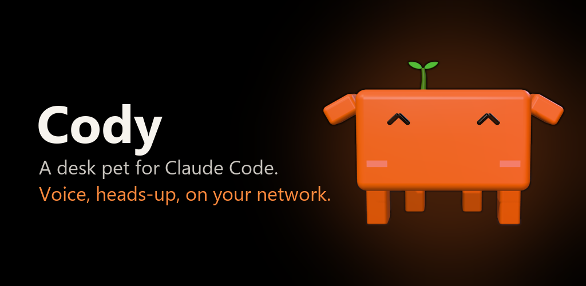
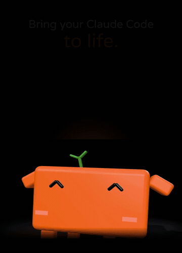
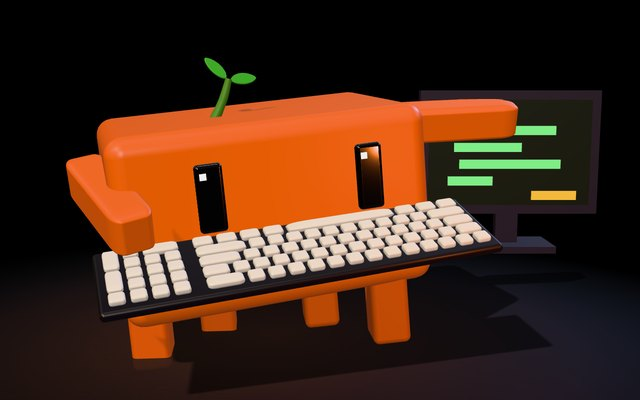
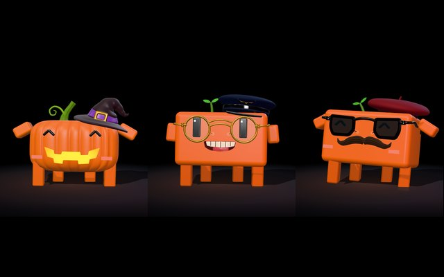

<p align="center">
  
</p>

<h3 align="center">Your Claude Code, alive on your desk. Talk to it, and it codes.</h3>

<p align="center">
  <a href="https://github.com/baconshow/cody/releases/latest/download/CodySetup.exe"></a>
  <a href="https://baconshow.github.io/cody/"></a>
</p>

<p align="center">
  <a href="LICENSE"></a>
  <a href="#windows-app"></a>
  <a href="#put-it-on-your-phone"></a>
  <a href="#claude-code-plugin"></a>
</p>

<p align="center">
  <a href="#install-in-three-steps">Install</a> ·
  <a href="#what-it-does">What it does</a> ·
  <a href="#with-your-kids-apps-by-talking">With your kids</a> ·
  <a href="#talk-to-it-voice">Voice</a> ·
  <a href="#skins">Skins</a> ·
  <a href="docs/MANUAL.md">Full manual</a>
</p>

<table>
<tr>
<td width="50%"></td>
<td width="50%"></td>
</tr>
</table>
<p align="center"><sub>The real Cody; the terminals and the cards are drawn, with made-up commands.</sub></p>

**A little orange desk pet for Claude Code.** It reacts, live, to what Claude does on your computer. Say *"Cody"* and
your words go into a real Claude Code session, with your files and your tools; pick a voice and Cody answers out loud. When that session
asks for permission, Cody asks you. Free and MIT, on your own Claude subscription; nothing is sent to the author.

> **Unofficial fan project.** Not affiliated with, endorsed by or sponsored by Anthropic. Claude and Claude Code are
> trademarks of Anthropic, PBC. Cody is fan art. Not related to Sourcegraph's Cody either.

## What it does

<table>
<tr>
<td align="center" width="33%"><br><b>Reacts to every step</b><br><sub>types along while Claude writes code</sub></td>
<td align="center" width="33%"><br><b>Thinks while commands run</b><br><sub>a thought bubble over its head</sub></td>
<td align="center" width="33%"><br><b>Talks back</b><br><sub>a real Claude Code session, out loud</sub></td>
</tr>
<tr>
<td align="center"><br><b>Skins</b><br><sub>a pumpkin, an aviator, the boss</sub></td>
<td align="center"><br><b>Headphones on</b><br><sub>when your music plays (Windows)</sub></td>
<td align="center"><br><b>A little window</b><br><sub>over your apps (from Chrome or Edge)</sub></td>
</tr>
</table>
<p align="center"><sub>The real page; the words in "Talks back" and the desktop in "A little window" are added.</sub></p>

Say *"Cody"*, then:

- **Message your other Claude conversations.** *"Tell the payments session to run the tests."* Claude can message another
  Claude Code session running on the computer, a local one in the **Claude Desktop** app's Code tab included. It arrives
  marked as coming from another session, and the receiver's own permissions decide.
  [More](docs/MANUAL.md#your-other-claude-sessions)
- **Change your project.** *"Add a dark mode toggle to the settings page."*
- **Change Cody.** *"Draw a mustache on yourself."* Claude makes the scene and Cody wears it.

## With your kids: apps by talking

I made Cody with my kids in mind: they invent it, you say it to the mascot, and it shows up on the screen. Toys, games
and experiments, not apps for production, and the real skill underneath: saying exactly what you want, then changing it
until it is right.

- *"Make a game where a cat catches falling fish, and the score goes up."*
- *"A dinosaur quiz with three questions and confetti at the end."*
- *"A birthday card for grandma that plays a song when you click it."*

Then *"bigger"*, *"slower"*, *"add a sound"*. **You do the talking, on your own Claude account**
([18 or over, yours alone](https://www.anthropic.com/legal/consumer-terms)). Cody adds no protection of its own:
[what to set first](docs/MANUAL.md#with-your-kids-apps-by-talking).

## Install in three steps

You need [Claude Code](https://code.claude.com), installed and signed in.

1. **[Download `CodySetup.exe`](https://github.com/baconshow/cody/releases/latest/download/CodySetup.exe)** and open
   it (Windows). On macOS and Linux, [from source](#quick-start-from-source-any-system).
2. **Open Cody.** The first run opens the voice session (a terminal with Claude Code) and, for your phone, the private
   network.
3. **Scan the QR codes** with your phone (the Tailscale app, then Cody), or keep Cody in a browser tab.

## The short manual

Every **More** opens the [full manual](docs/MANUAL.md).

### Talk to it (voice)

Hold Cody, or say *"Cody"*, and ask. Claude does the work in the voice session and Cody answers in a sentence or two;
links and commands show on screen. When Claude asks for permission, say just *yes* or *no* within a minute; what is too
long to show, most new files included, is answered in the terminal. Also: timers, reminders, a memory of how you like
things, a mini Cody that points at the button you asked about (Windows), and a clip to send a picture. [More](docs/MANUAL.md#talk-to-it-voice)

### Heads-up from your other sessions

Turn these on in Settings. A long task finishes, or Claude waits for you, in any Claude Code session: Cody hops, knocks
on the screen and says so (with the Android app and its switch, the phone buzzes too). Your plan's usage, said out loud.
Cody typing along when you type to Claude. Your important Windows notifications, read aloud.
[More](docs/MANUAL.md#heads-up-from-your-other-claude-code-sessions)

### Put it on your phone

Settings > **Create your private network**: Cody sets up [Tailscale](https://tailscale.com) (never its public Funnel) and
shows the QR codes. By default only your own login gets in. The phone needs the Tailscale app; talk from Chrome. The
Android app (notifications, widget) is not on Google Play yet. [More](docs/MANUAL.md#put-it-on-your-phone)

### Windows app

`CodySetup.exe` installs for your user only, no Python needed, and lives next to the clock. Windows SmartScreen warns
the first time (the installer is not signed yet): **More info**, then **Run anyway**. [More](docs/MANUAL.md#windows-app)

### Claude Code plugin

```
/plugin marketplace add baconshow/cody
/plugin install cody@cody
```

Brings the heads-up hooks and `/cody:setup`, `/cody:status` and `/cody:voice`. [More](docs/MANUAL.md#claude-code-plugin)

### Quick start (from source, any system)

Python 3.10+ and Claude Code; nothing to `pip install`.

```bash
git clone https://github.com/baconshow/cody
cd cody
python cody.py --open
```

[More](docs/MANUAL.md#quick-start-from-source-any-system)

### Skins

A pumpkin, an aviator, the boss and more, free, in Settings > Skins. Scenes and skins are data, not code (JSON in
`web/scenes/` and `web/skins/`), and Claude can make a new scene for Cody by voice. [More](docs/MANUAL.md#skins)

### What it costs

On a Claude Pro or Max plan, nothing extra. A nicer ElevenLabs voice is optional. [More](docs/MANUAL.md#what-it-costs)

### Privacy and security

No telemetry; nothing is ever sent to the author ([PRIVACY.md](PRIVACY.md)). The server listens on your computer
only, every API request needs a token that changes on each start, and by default only your own Tailscale login gets
in from the phone. [More](docs/MANUAL.md#privacy-and-security)

## More

[Full manual](docs/MANUAL.md) · [CHANGELOG](CHANGELOG.md) · [Privacy](PRIVACY.md) · [Security](SECURITY.md) ·
[Contributing](CONTRIBUTING.md) · [Manual tests](docs/MANUAL-TESTS.md) · MIT [license](LICENSE)
