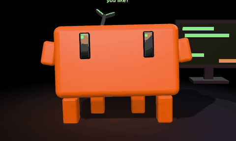

# Cody

A little desk pet for [Claude Code](https://code.claude.com). It lives on your phone (or in a browser tab), watches
what Claude is doing on your computer and reacts: it grabs a magnifier when Claude searches, types on a tiny
keyboard when Claude writes code, thinks while commands run, hops when a subagent finishes, gets sleepy when nothing
happens and falls asleep (zzZ) when Claude is closed.

You can also **talk to it**. Hold Cody (or say "Cody") and ask anything: your words go into a real Claude
Code session on your computer, and the mascot answers out loud in one or two short sentences. Honestly, it answers
far better than Alexa, because it *is* Claude Code: your files, your tools, your context.

It also does the desk-buddy things: **timers and reminders** that ring on the phone, a **memory** of your name and
how you like things, a **mini Cody that flies across your computer screen** to point at the button you asked about,
and a **heads-up** when one of your Claude Code sessions finishes a long task or is waiting for your permission.



> **Unofficial fan project.** Not affiliated with, endorsed by or sponsored by Anthropic. Claude and Claude Code are
> trademarks of Anthropic, PBC. Cody is fan art. Not related to Sourcegraph's Cody either.

## What it costs

**Nothing extra, out of the box.**

| Piece | Cost |
|---|---|
| Cody | Free, MIT license |
| Claude | **No API key and no API billing.** Voice commands run inside your normal Claude Code session, so they count against your Claude subscription (Pro or Max) like any message you type |
| Phone access | [Tailscale](https://tailscale.com/pricing) Personal plan: free (up to 6 users, unlimited devices) |
| Mascot voice | Your phone's built-in voice: free and unlimited |
| Nicer voice (optional) | [ElevenLabs](https://elevenlabs.io/pricing): free tier of 10,000 credits a month, paid plans from $6 a month |

### Optional ElevenLabs voice: a cost simulation

The mascot is told to answer in at most two short sentences, so a reply is about **100 characters**. With the
default model, Flash v2.5, ElevenLabs charges between 0.5 and 1 credit per character through the API. Plans and
prices from the ElevenLabs pricing page, checked October 2026:

| Plan | Price | Credits a month | Spoken replies a month | About per day | Cost per reply |
|---|---|---|---|---|---|
| Free | $0 | 10,000 | 100 to 200 | 3 to 6 | $0 |
| Starter | $6/month | 30,000 | 300 to 600 | 10 to 20 | 1 to 2 cents |
| Creator | $22/month | 121,000 | 1,210 to 2,420 | 40 to 80 | about 1 to 2 cents |

The free tier covers casual use. If you talk to it a lot, Starter costs about a cent or two per answer. Unused
credits roll over for up to two months. Only what the mascot says out loud is sent to ElevenLabs (Claude's short
replies and its "can I run a command?" questions), never your question or your files. Without a voice configured,
nothing goes to ElevenLabs at all. Synthesis is capped at 20 replies a minute, so a leak can't drain your credits.

## Windows app

Download **CodySetup.exe** from the [latest release](https://github.com/baconshow/cody/releases/latest) and run it.
No Python needed, no admin rights: it installs for your user only.

- Cody lives in the notification area (next to the clock). Its menu: **Open Cody**, **Status**, **Start voice
  session**, **Settings**, **Start with Windows** and **Quit**.
- Opening Cody starts everything: the mascot server, the mascot in your browser and the voice session (a terminal
  window with Claude Code; confirm the development channel there once, see [Talk to it](#talk-to-it-voice)). You
  never start two terminals by hand. Started with Windows, it stays quiet in the tray until you open it.
- **Windows SmartScreen will warn you** the first time ("Windows protected your PC"), because the installer is not
  signed with a paid code-signing certificate yet. Click **More info**, then **Run anyway**. The installer is built
  by GitHub Actions from this repository ([`packaging/`](packaging), workflow `Windows app`); you can check the
  build log of any release.
- Uninstalling (Settings, Apps) also takes Cody's hooks out of Claude Code's settings. Your timers and memory stay
  in `%LOCALAPPDATA%\cody` until you delete that folder.

## Claude Code plugin

Cody is also a Claude Code plugin, from the marketplace in this repository. In Claude Code:

```
/plugin marketplace add baconshow/cody
/plugin install cody@cody
```

(Claude Code 2.1.275 or later can do it in one step: `/plugin install cody --marketplace baconshow/cody`.)

The plugin brings Cody's heads-up hooks and three commands:

| Command | What it does |
|---|---|
| `/cody:setup` | Checks everything, starts the mascot server if it is off and walks you through what is missing |
| `/cody:status` | What is on and off: server, voice session, hooks, Tailscale, phone, voice |
| `/cody:voice` | Opens the voice session in a new terminal window |

Nothing to edit by hand. With the plugin on, `--install-hooks` does nothing (the plugin already has the hooks), so
they never run twice. The plugin does not load the voice channel into every session: a plugin's MCP server would
start in all of them, and the channel only belongs in the voice session, which `/cody:voice` opens. The hooks and
commands need Python 3 (`python3`, `python` or `py`), or the Windows app.

## Quick start (from source, any system)

You need **Python 3.10+** and **Claude Code**. Nothing to `pip install`: the server uses only the standard library.

```bash
git clone https://github.com/baconshow/cody
cd cody
python cody.py --open
```

That opens the mascot at `http://127.0.0.1:7420`. Use Claude Code as usual and watch it react.

**It sets itself up.** The first time, Cody asks two questions in the terminal (Enter means yes):

- *Open Cody on your phone through Tailscale?* If Tailscale runs on the computer, Cody shares itself in your private
  tailnet (`tailscale serve`, never Funnel), on a free HTTPS port so anything you already serve stays as it is, and
  prints the address to open on the phone. Only your own Tailscale login gets in.
- *Tell you on the phone when Claude finishes a long task or needs you?* Adds three Claude Code hooks (see
  [Heads-up](#heads-up-from-your-other-claude-code-sessions)).

A "no" is remembered. `python cody.py --setup` asks again; `--no-setup` skips all of it. The language follows the
computer's (Portuguese or English) unless you set it.

Nothing else to configure. To change something, copy `config.example.json` to `config.json` and edit it (the
Windows app keeps its `config.json` in `%LOCALAPPDATA%\cody`):

| Key | Default | What it does |
|---|---|---|
| `port` | `7420` | Local port |
| `language` | the computer's | `"en"` or `"pt-BR"`: spoken replies, wake word and screen text |
| `extra_hosts` | found by itself | More host names allowed besides localhost (Tailscale addresses that forward to Cody are found at start) |
| `allowed_logins` | your own login | The Tailscale logins that may use it from the phone |
| `voice` | `null` | Optional ElevenLabs voice: `{"voice_id": "...", "model": "eleven_flash_v2_5"}` |
| `voice_folder` | current folder | Folder the voice session works in (the Windows app's default is your home folder) |

## Scenes

What Cody does around itself follows what Claude really does: a monitor full of code while Claude edits files, a
speech bubble with "..." while a command runs, a black bug and a `> DEBUG MODE` sign when a command or a test fails,
confetti when a long task finishes, a coffee mug after a quiet while, a nightcap when it sleeps, and headphones for
music (once music detection lands). Scenes are data, in `web/scenes/scenes.json`: voxel boxes, a trigger, simple
clips, a sound and a priority (the highest one whose trigger is on wins), so new scenes and skins are a JSON edit.
Try one with `?scene=debug` (or `coding`, `thinking`, `coffee`, `party`, `headphones`, `sleeping`). With "reduce
motion" on, scenes appear without moving. Only the failure itself is read from the transcripts, never its output.

## Is everything on?

The light in the corner of the mascot says it at a glance (green: all good; red: something to fix, for example
"voice session closed"). Tap it for the **Status** screen: server, voice session, voice channel, hooks, Tailscale,
phone, microphone, sound and voice, each with one plain sentence, what to do and, where Cody can do it, a button.
Buttons that change the computer (open the voice session, add the hooks) only work on the computer itself, not
from the phone. Errors show their real reason, for example `ElevenLabs: payment pending`.

The same checks in the terminal: `python cody.py --doctor` (or `/cody:status` in Claude Code). If two voice
sessions are open, Cody says so: only the newest one hears you.

## Settings and the first run

The first time you open Cody on the computer, it walks you through three steps, out loud: language and voice, the
phone (a QR code to scan), and the voice session, ending in "say hi". **Settings** (the gear in the top corner of
the mascot page, the tray menu, or the page's `#settings`) opens beside the mascot and has the rest: voice
(ElevenLabs with your own key and a **Test** button, the device's voice or Cody's sounds; Cody's hosted voice is
listed as coming soon), the phone, language, the hooks, starting with Windows and privacy. Next to the gear, a small
light shows whether Cody is listening for its name (green) or not (red); a tap switches it.

- The key is typed in Settings, saved in Cody's data folder on this computer only (readable only by you), and never
  shown again: the page only learns that a key is there.
- Settings change only on the computer itself; from the phone you can switch the language of that phone's screen.
- The QR codes are drawn on your computer (`cody/qr.py`): no web service ever sees your address.

## Put it on your phone

**The easy way:** Settings > **Create your private network**. Cody takes you through it without a terminal: it
installs Tailscale if it is missing (`winget` on Windows, the official download page elsewhere), opens the sign-in
page, sends you to the Tailscale admin page if MagicDNS or HTTPS certificates are off, shares itself with
`tailscale serve`, and shows two QR codes: the Tailscale app for your phone, and Cody's private address. Only your
own devices can see Cody. Your phone needs the Tailscale app too, signed in to the same account.

**By hand:**

The server only listens on `127.0.0.1`. To reach it from your phone, Cody uses Tailscale **serve**, which keeps it
inside your private tailnet. Never use `tailscale funnel`: that would put your mascot (and its voice channel into
Claude) on the public internet. Cody refuses Funnel requests and never trusts a Funnel address.

1. Install [Tailscale](https://tailscale.com/download) on your computer and your phone, and sign in to the same
   account on both.
2. In the Tailscale admin console, under **DNS**, enable **MagicDNS** and **HTTPS certificates**.
3. Start Cody and answer yes to the phone question. It prints the address, for example
   `https://my-pc.tail1234.ts.net`. (By hand: `tailscale serve --bg 7420`, then restart Cody: it finds the address.)
4. Open the address on your phone and use **Add to Home screen**. It runs full screen, landscape, and keeps the
   screen awake.

Only your own Tailscale login gets in, even if other people or shared devices are in your tailnet. To let someone
else in, list their logins in `allowed_logins`. A tagged Tailscale machine has no login of its own: then Cody warns
you and trusts every device in your tailnet until you set `allowed_logins`.

Shake the phone and the mascot holds on to the edges of the screen for dear life.

## Talk to it (voice)

Voice uses Claude Code [channels](https://code.claude.com/docs/en/channels), a research preview. Channels work when
you sign in to Claude Code with your claude.ai account (Pro or Max) or a Console API key. On Team and Enterprise
plans an admin has to enable them first.

1. Start the voice session in the folder you want Claude to work in. In the Windows app: the tray menu's **Start
   voice session** (it opens in your home folder, or in `voice_folder` from `config.json`). From source:
   ```bash
   python cody.py --voice            # any system; or .\scripts\voice.ps1 / ./scripts/voice.sh
   ```
   Claude Code asks you to confirm the development channel: choose **I am using this for local development**.
2. On the mascot, **hold** it and speak, or say **"Cody"** (or "Claude") followed by your request.
3. Claude does the work in that session and the mascot speaks a short answer. Links, commands and file paths are
   never read aloud: they show up on screen to tap and copy.
4. When Claude needs permission to run something, the mascot asks out loud and shows the command. Answer with
   just **yes** or **no** within a minute; a sentence like "ok, stop" counts as neither. Commands too long to show
   in full must be approved in the terminal. The terminal prompt stays open too; whichever answers first wins.
5. Ask for a screenshot: *"take a screenshot and send it to my WhatsApp"*. Claude takes it on the computer (you
   approve the tool like any other), and the picture pops up on the phone with **Share** and **Save**. Tap Share and
   pick WhatsApp, or any other app. Claude only gets an id, never the picture, and nothing is uploaded anywhere
   except where you share it. Screenshots happen only when you ask: there is no periodic capture.

The voice session lets Cody's harmless tools run without asking (reply, timers, memory, pointing). The two that
capture your screen, `screenshot` and `look`, always ask first, by voice too.

**Your other MCP servers work by voice too.** The voice session is a normal Claude Code session with Cody's channel
added, so whatever you already connected to Claude Code (Airtable, a calendar, your smart home) is there: *"Cody,
what is on my roadmap this week?"*. Cody pre-approves only its own harmless tools; a tool from another server asks
permission like always, and you answer **yes** or **no** out loud.

### Timers and reminders

*"Cody, set a timer for ten minutes for the pizza"*, *"a 25 minute focus timer"*, *"remind me at 3:30 to call
Ana"*, *"cancel the pizza timer"*, *"what timers are running?"*

The countdown shows in the corner of the phone. When it ends, Cody hops, the phone buzzes and chimes, and the mascot
says what it was for, until you tap the timer (or a minute goes by). Reminders more than an hour away show the time
of day instead of a countdown. Timers live on your computer (`timers.json` in Cody's data folder, see below), so they
keep running after you close the voice session or reload the phone. The phone has to be on to ring, like any desk
clock.

### Memory

*"My name is Ana"*, *"remember that I like short answers"*, *"forget my address"*

Claude saves short facts with Cody's `remember` tool and gets them back at the start of every voice session, so Cody
doesn't forget your name. They stay in `memory.json` in Cody's data folder, on your computer only: no account, no
cloud, no sync. Delete the file to make Cody forget everything. At most 40 facts.

### Cody on your computer screen (Windows)

*"Cody, where is the export button?"*

Claude takes a look at your screen (the `look` tool, which asks your permission), finds the spot, and a mini Cody
flies there and points at it with a little speech bubble: *"Right here! Click Export"*. Meanwhile the mascot on the
phone turns and points the same way. The mini Cody is a see-through window you can click through; it never takes
the focus and leaves after eight seconds.

Unlike `screenshot`, **`look` does send the picture to Claude**, scaled down, as part of the conversation: that is
how Claude finds the button. It only happens when you ask about something on the screen. To forbid it, deny
`mcp__cody__look` in Claude Code's permissions. Pointing is Windows only for now (macOS and Linux: PRs welcome).

Speech recognition uses your browser's Web Speech API. Chrome on Android and on the desktop works best. In Chrome,
the audio is transcribed by Google's speech service.

## Heads-up from your other Claude Code sessions

Cody can tell you when Claude finishes a long task in any session (*"Done! Claude finished."*) or is waiting for
your permission (*"Claude needs you at the computer."*), so you can leave the desk while it works. It uses Claude
Code [hooks](https://code.claude.com/docs/en/hooks). Add them with:

```bash
python cody.py --install-hooks
```

That adds three small hooks (`UserPromptSubmit`, `Stop` and `Notification`) to your Claude Code user settings,
`~/.claude/settings.json`, keeping a backup at `settings.json.cody-backup` and everything else you have there. New
sessions pick them up. `python cody.py --uninstall-hooks` removes them.

Each hook writes one line to `events.jsonl` in Cody's data folder: the time, the kind of event and the first
characters of the session id. Never your prompt, Claude's reply or a command. A turn shorter than 20 seconds ends
without a word (the face already showed the work), and the voice session is skipped, since there Cody already does
the talking.

Prefer to add them by hand? Each one is a command hook running `"<python>" "<path to>/cody.py" --hook`.

### Four ways to sound

Settings > Voice picks the first one to try; when it fails, the next one speaks and the screen says so (for example
"ElevenLabs didn't work (payment pending): This device's voice instead"):

1. **ElevenLabs**, with your own key (below);
2. **Cody's hosted voice**, opt-in, not offered yet;
3. **this device's voice** (the browser's speech);
4. **Cody's sounds**: no words, little chirps in the rhythm of the text while it shows on screen. They always work.

Cody's sounds also mark what happens: thinking, done, an error, calling you, a timer ringing, a startle. A tap on
Cody is silent: tapping and holding it is how you talk to it, so it answers with a hop, not with a noise.
They are made from scratch by `tools/make_sounds.py` (only the Python standard library, no samples), live in
`web/sounds`, and are MIT like the rest. The mouth follows their volume.

### A nicer voice with ElevenLabs

1. Create an [ElevenLabs](https://elevenlabs.io) account (the free tier is enough to start).
2. Create an API key and paste it in **Settings > Voice** (or on the first step of the first run). It is saved on
   this computer only, in Cody's data folder. The `ELEVENLABS_API_KEY` environment variable and a `.elevenlabs-key`
   file in your home folder still work too.
3. With the key saved, Settings lists the voices of your ElevenLabs account. Pick one: Cody says hi with it right
   away, and it is saved. To use a voice from the ElevenLabs voice library, add it to your voices there first. If
   your key is not allowed to list voices (a key restricted to text to speech), Settings asks for a voice ID
   instead. By hand, the same thing in `config.json`:
   ```json
   { "voice": { "voice_id": "YOUR_VOICE_ID", "model": "eleven_flash_v2_5" } }
   ```

Listing the voices costs no credits; hearing one costs one short sentence (about 30 characters).

Never commit your key. `config.json` and `.elevenlabs-key` are already in `.gitignore`.

With a voice configured, timers and heads-up are spoken in it too. Their words are always made on the computer
from a fixed list (and the timer's label), never sent in by the phone.

## How it works

```
Claude Code ──writes──> ~/.claude/projects/**/*.jsonl ──read every 2 s──> cody.py ──> mascot (browser/phone)
                                                                                 │
phone mic ──Web Speech──> POST /api/voice ──> voice channel (MCP) ──> your Claude Code session
                                                                                 │
mascot speaks <── phone voice or ElevenLabs <── short reply (reply tool) <───────┘
```

- **Activity**: the server reads the tail of Claude Code's own transcripts. Only the tool name (and whether it
  edited a source file) reaches the page: never commands, file paths or conversation text.
- **Voice channel**: `cody/channel.py` is a tiny MCP server that Claude Code starts. It pushes what you said into
  the session and keeps Claude's short reply for the mascot. Its other tools (`cody/abilities.py`) set timers,
  save facts, look at the screen and send the mini Cody (`cody/overlay.py`, plain tkinter) to point.
- **Data folder**: `%LOCALAPPDATA%\cody` on Windows, `~/.local/state/cody` elsewhere. Small JSON files shared by
  the server, the channel and the hooks: timers, memory, hook events. Readable only by you.
- **Mascot**: three.js (bundled in `web/vendor/three`, MIT), with a pixel-art 2D fallback. The face motion (springs, blinks, glances)
  is ported from the face animator of the public-domain Bluey app.
- **Cursor follow**: on Windows the mascot looks at your mouse pointer. Other systems: PRs welcome.

## Privacy and security

- No telemetry. Cody never sends anything to its author (the full list of what goes where is in
  [PRIVACY.md](PRIVACY.md)). The update check is off by default; on, it asks GitHub once a day for the latest
  version number. Timers, memory and hook events stay in the data folder on
  your computer. What does leave it, as part of using Claude and the voice you chose: the saved facts reach Claude
  with the first thing you say in each voice session, and with an ElevenLabs voice the timer labels are spoken by
  ElevenLabs when they ring.
- Screenshots are taken only on request, kept in memory (the latest three) and never written to disk on Windows
  (macOS and Linux use a temp file that is deleted right away). The `screenshot` picture goes to your phone only;
  the `look` picture goes to Claude, so it travels like anything else in your Claude Code conversation. Both ask
  first. If your screen may show things that must not leave the computer, deny `mcp__cody__screenshot` and
  `mcp__cody__look` in Claude Code's permissions.
- The server binds to `127.0.0.1`. Every request needs an allowed `Host` header, every `/api` route needs a random
  token that changes on each start, and cross-site requests are refused. Requests through Tailscale Funnel are
  always refused; set `allowed_logins` to keep the rest of your tailnet out.
- Trust model: anyone who can load the page can talk to your Claude session. That means programs on this computer
  and, without `allowed_logins`, every device in your tailnet. Voice messages are capped at
  20 a minute.
- The voice channel listens on `127.0.0.1` only and needs a secret that lives in a file readable only by you.
- Outside connections: your browser's speech service, and ElevenLabs only if you configure a voice. three.js and the
  font (Varela Round, SIL Open Font License) ship with Cody, so the page loads no CDN and works without internet.

## Tests

```bash
python -m unittest discover tests
node --test "tests/js/*.test.mjs"
```

## URL options

Handy for tinkering: `?lang=pt-BR`, `?visual=2d`, `?gallery=1` (all moods side by side), `?mood=sleepy`,
`?prop=keyboard`, `?grab=1` (the shake startle), `?curse=1` (the swearing after it),
`?sensor=1` (shows the accelerometer readings).

## More

[CHANGELOG](CHANGELOG.md) · [Privacy](PRIVACY.md) · [Security](SECURITY.md) · [Contributing](CONTRIBUTING.md) · [Manual tests](docs/MANUAL-TESTS.md)

## License

MIT. See [LICENSE](LICENSE).
